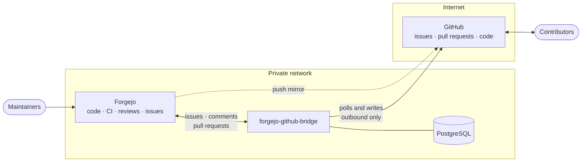
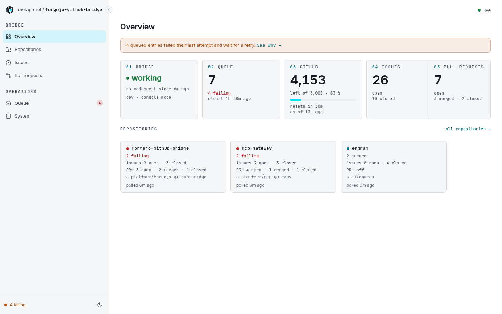

<p align="center">
  <picture>
    <source media="(prefers-color-scheme: dark)" srcset=".metapatrol/forgejo-github-bridge-lockup-dark.png">
    
  </picture>
</p>

<p align="center">
  <strong>Develop in a private Forgejo. Take contributions on GitHub.</strong>
</p>

<p align="center">
  <a href="https://github.com/metapatrol/forgejo-github-bridge/releases"></a>
  <a href="LICENSE"></a>
  <a href="https://github.com/metapatrol/forgejo-github-bridge/pkgs/container/forgejo-github-bridge"></a>
  
</p>

<p align="center">
  <a href="docs/installation.md">Installation</a> ·
  <a href="docs/README.md">Documentation</a> ·
  <a href="docs/faq.md">FAQ</a> ·
  <a href="docs/design.md">Design</a> ·
  <a href="CONTRIBUTING.md">Contributing</a> ·
  <a href="SECURITY.md">Security</a>
</p>

---

## Why

You keep your code, your CI and your issue tracker in a Forgejo that the
internet cannot reach. You still want to publish some projects as open source,
and outside contributors expect GitHub: its issues, its pull requests, its
notifications.

forgejo-github-bridge connects the two. Contributors use GitHub as they would
for any project. Maintainers keep working in Forgejo. Issues, pull requests and
conversations cross between them — and nothing on the internet can reach into
your network, because the bridge only ever connects out.

## How it works



- **Code** goes out through Forgejo's own push mirror. The bridge never pushes
  to GitHub.
- **Everything else** — issues, comments, pull requests and their outcome — is
  carried by the bridge, in both directions, by polling GitHub's API.
- **Nothing comes in.** There is no webhook, no public endpoint and no route
  into the private network.

## Features

**Issues**

- GitHub issues appear in Forgejo, labelled `github`, with who reported them.
- Forgejo issues stay private unless you label them `public`.
- Comments cross both ways; one starting with `/internal` stays in Forgejo.
- Closing and reopening work from either side.
- `#123`, `@mentions` and links into Forgejo are translated, so nothing
  internal leaks and nobody unrelated is pinged.

**Pull requests**

- A pull request on GitHub is imported into Forgejo, where your CI and review
  run as usual.
- Its workflow runs **wait for a maintainer's approval**: imported pull
  requests come from an account without write access.
- New commits follow; a branch someone else pushed to is never overwritten.
- Changes to CI configuration are labelled and flagged.
- Reviews and comments reach the contributor, line comments on their lines;
  the merge is reported back —
  as *merged* when it was a fast-forward, with the commit when it was rebased.
- Optionally, a friendly request to rebase when the pull request falls behind.

**Operations**

- One small binary and a PostgreSQL database. Runs anywhere a container
  runs; a Helm chart and a Docker Compose setup are included.
- Idempotent reconciliation: every failure is retried, nothing is lost across
  restarts or outages, and a lost database can be rebuilt.
- Prometheus metrics and a ready-made Grafana dashboard.
- An optional read-only console, live: every issue and pull request with
  links to both sides and its history, the queue with the reason anything is
  stuck, the GitHub rate limit, and the database and its upkeep.
- Everything the bridge says in its own voice is a template you can reword.

<p align="center">
  
</p>

## Quick start

You need a PostgreSQL database, somewhere to run a container, a Forgejo
instance with a push mirror to your GitHub repository, and a GitHub
organisation.

1. **Create a GitHub App** with *Issues* and *Pull requests* set to read and
   write and its webhook turned off, install it on the repository, and store
   its private key in a Secret.
2. **Create a Forgejo account** for the bridge with write access to the
   repository, and store its token in a Secret. For pull requests, a second,
   read-only account; the bridge forks the repository for it.
3. **Run it**, with Docker Compose from [samples/compose](samples/compose/):

   ```bash
   docker compose up -d
   ```

   or on Kubernetes with the Helm chart:

   ```bash
   helm upgrade --install forgejo-github-bridge \
     oci://ghcr.io/metapatrol/charts/forgejo-github-bridge \
     --namespace forgejo-github-bridge --create-namespace -f values.yaml
   ```

The [installation guide](docs/installation.md) walks through every step,
including the checks to run before the first real contribution.

## Documentation

| | |
|---|---|
| [Installation](docs/installation.md) | from nothing to a bridged repository, step by step |
| [Configuration](docs/configuration.md) | every setting, the repository file and the message templates |
| [Maintainers](docs/maintainers.md) | day to day in Forgejo: publishing, approving CI, merging, closing |
| [Operations](docs/operations.md) | metrics, alerts, troubleshooting, upgrades, recovery |
| [Console](docs/console.md) | the optional read-only web console |
| [Architecture](docs/architecture.md) | how it works inside |
| [Security](docs/security.md) | what a contributor cannot make it do, and the rules that keep it so |
| [FAQ](docs/faq.md) | why polling, why a second account, why a fork, and more |
| [Development](docs/development.md) | building, testing and changing it |
| [Design](docs/design.md) | the design record: every decision and its reasons |

## Status

The bridge is in the 0.x series. Issues and pull requests are complete and
tested end to end against GitHub and Forgejo 16, and the read-only
[console](docs/console.md) shows what the bridge holds. Maintainers' line
comments reach the contributor on their lines. Next on the
[roadmap](docs/design.md#19-phases): CI status on GitHub.

## Contributing

This repository is developed in a private Forgejo and published here —
through itself. Open issues and pull requests on GitHub as usual; the bridge
carries them to the maintainers, and their answers come back the same way.
See [CONTRIBUTING.md](CONTRIBUTING.md).

## License

[Apache License 2.0](LICENSE)
