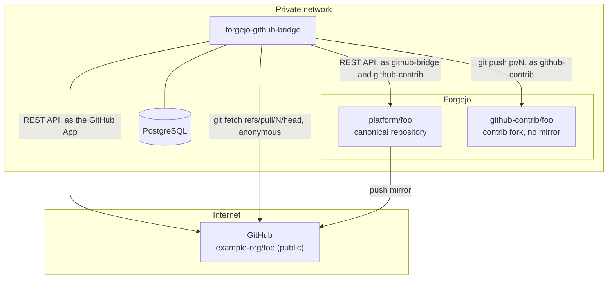
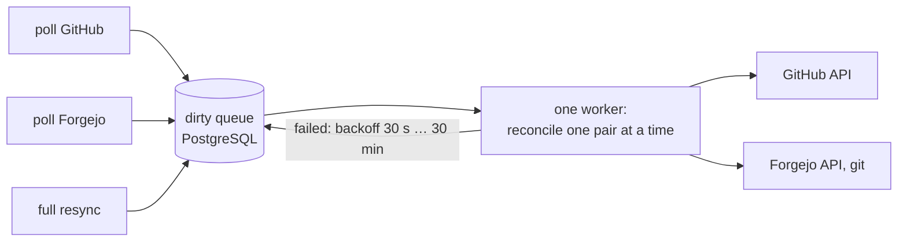
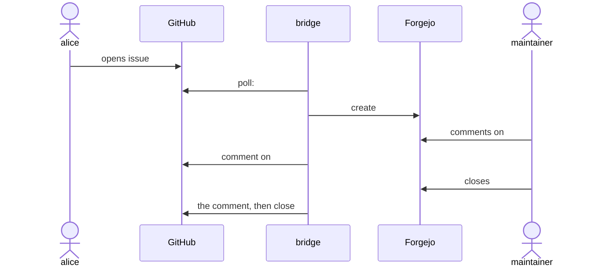
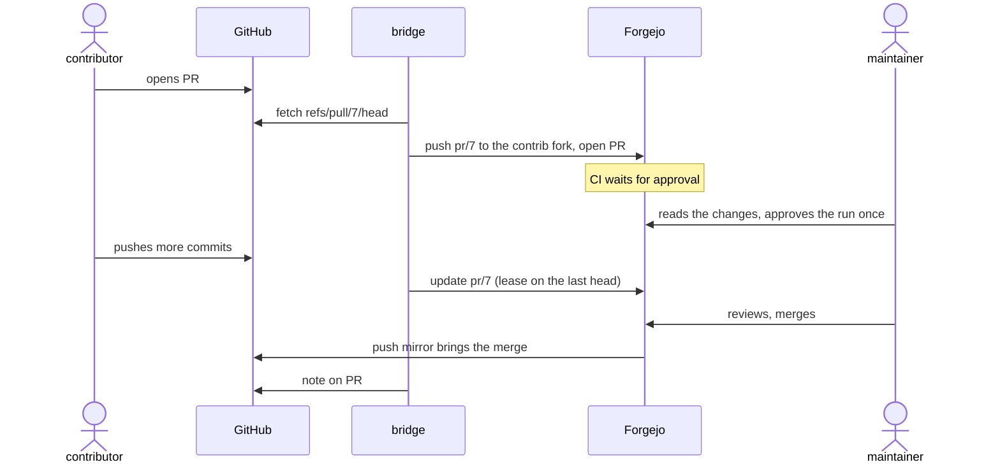

# Architecture

This page describes how the bridge works as built. The reasoning behind the
design is in the [design record](design.md); where the two differ, the design
records the decision and this page the result.

**Contents**

- [The pieces](#the-pieces)
- [Processing model](#processing-model)
- [State](#state)
- [One active instance](#one-active-instance)
- [Identities](#identities)
- [An issue's way across](#an-issues-way-across)
- [A pull request's way across](#a-pull-requests-way-across)
- [Content translation](#content-translation)
- [Failure behaviour](#failure-behaviour)

## The pieces



- **One process.** The binary `forgejo-github-bridge` polls, queues and
  reconciles. It runs in the private network and only connects out.
- **PostgreSQL** holds which item on one side corresponds to which on the
  other, how far each poll has read, and the queue of work.
- **Forgejo's push mirror** is what moves code to GitHub. The bridge never
  pushes to GitHub and never pushes to the canonical Forgejo repository.
- **The contrib fork** is a Forgejo fork of the canonical repository, owned
  by the `github-contrib` account. Imported pull request heads are pushed
  there, and the imported pull requests are opened from it.

## Processing model



### Polls

Every `BRIDGE_POLL_INTERVAL` (default 60 s), for every repository pair and
each side, the bridge lists issues (including pull requests) and comments
updated since its cursor. It does not act on what it reads. It only marks the
issues that changed as *dirty*.

- **Cursors** are the latest update time the forge itself reported, never the
  bridge's clock. Each poll starts two minutes before its cursor, because
  both forges index updates asynchronously.
- **The overlap** would make the most recent change of a quiet repository
  come back on every poll. The poller remembers, in memory, what it queued
  within the window, and queues an item again only when its update time
  moved.
- **The bridge's own comments** are not queued: their issue changed because
  the bridge changed it.
- **GitHub list requests** carry the previous ETag. An unchanged answer
  comes back as `304 Not Modified`, which does not count against the rate
  limit.

### The queue

The queue is a PostgreSQL table with one row per resource, keyed by
repository, side and number. A mapped Forgejo issue is keyed by its GitHub
number, so a change on each side of one pair is one entry. Marking an entry
that exists only moves its `marked_at`, which coalesces bursts: five changes
to one pull request between two polls are one reconcile.

A single worker takes the entry that has been due the longest and
reconciles it. After success it deletes the entry, but only if `marked_at`
did not change meanwhile; a change that arrived during the reconcile keeps
it queued. After failure it records the error in `last_error`, counts the
attempt, and holds the entry back with exponential backoff from 30 seconds
to 30 minutes.

One worker, on purpose: the two halves of a pair can both be queued, and two
workers reconciling the same pair would each see a comment without a
projection and each create one.

### Full resync

Every `BRIDGE_FULL_RESYNC` (default 6 h) every pair that was open at its last
reconcile is queued, whether or not a poll saw it change. This is what
notices deletions, which incremental polls cannot see, and what re-renders
projections whose references became resolvable since.

### Reconcile

A reconcile reads the **whole current state** of both sides of a pair, not
what changed, and makes them agree. Running it twice does what running it
once did, which is why every failure is handled the same way: try again
later.

## State

| Table | Holds |
|---|---|
| `issue_mapping` | pairs: repository, kind (`issue` or `pull`), GitHub number, Forgejo number, which side it originated on, the open/closed state both sides had after the last reconcile |
| `comment_mapping` | comment pairs of a mapped issue or pull request; Forgejo reviews are stored under their negated ID, since Forgejo numbers reviews and comments separately |
| `pull_request_state` | per pull request pair: contrib branch, the head the bridge last pushed, open/merged/closed, whether the branch is frozen, whether it touches CI, the rebase comment and whether it currently asks for a rebase, whether the outcome was reported |
| `poll_cursor` | per repository, side and stream (issues, comments) |
| `dirty` | the queue |
| `schema_migration` | applied migrations and their checksums |

The mapping tables are the authority on what corresponds to what. Every
projection additionally ends in a hidden marker:

```html
<!-- forgejo-github-bridge origin=github kind=comment id=927362 -->
```

Markers are not trusted, because anyone can type one into an issue. They are
read only from items the bridge's own accounts wrote, and only to rebuild
mappings the database does not have (see [Operations](./operations.md#losing-the-database)).
Markers are stripped from every text before it crosses, so a pasted one
cannot give a projection a second, forged origin.

Migrations are embedded in the binary and applied at startup under an
advisory lock. An applied migration whose file changed stops the start.

## One active instance

The bridge holds a PostgreSQL advisory lock for as long as it works. A second
replica waits on it and takes over within about five seconds of the first
one's session ending: on a rollout, the new pod waits until the old one has
stopped. If the connection holding the lock fails, the instance exits rather
than risk working next to another.

## Identities

| Where | Account | Used for |
|---|---|---|
| GitHub | the GitHub App (`<slug>[bot]`) | reading issues and pull requests, writing issues, comments and state. Installation tokens are requested per repository and restricted to it |
| GitHub | none | `git fetch` of pull request heads from public repositories |
| Forgejo | `github-bridge` | issues, comments, labels, closing and reopening, editing pull request descriptions. Write access to the canonical repository |
| Forgejo | `github-contrib` | pushing to the contrib fork, opening imported pull requests. **Read-only** on the canonical repository |

Everything any of these accounts wrote is a projection, never a source. That
is the whole loop prevention: the bridge ignores its own writes, and for a
projection that exists it renders what it should say from the current
source and writes only if that differs.

## An issue's way across



**From GitHub.** A contributor opens GitHub #42.

1. The GitHub poll sees it and queues `github #42`.
2. The reconciler finds no mapping. It checks that the bridge did not already
   create a projection it failed to record (opened by `github-bridge` in the
   last day with a marker naming #42), then creates Forgejo #71 with the
   `github` label and records the pair.
3. It reconciles the pair: title and body follow GitHub; comments are
   projected both ways; a Forgejo comment starting with `/internal` is not.
4. Closing or reopening on either side is carried to the other. The mapping
   remembers the state both sides had last time, so the side that differs is
   the side that acted.

**From Forgejo.** A maintainer opens Forgejo #80. Nothing happens until it
carries the `public` label. Then the bridge creates GitHub #43 and bridges it
like any other pair, with Forgejo as the source of title and body. Removing
the label later freezes the pair in both directions.

Closed issues are never imported or published. A GitHub issue opened before a
repository's `importSince` is never imported.

## A pull request's way across



1. A contributor opens GitHub PR #7 from their fork against `develop`.
2. If `develop` is not in `targetBranches`, the bridge explains once on
   GitHub and waits; changing the base picks it up.
3. The bridge fetches `refs/pull/7/head` from GitHub anonymously and pushes
   it to `pr/7` in the contrib fork with `--force-with-lease=pr/7:` (the
   branch must not exist). The Git cache keeps one bare repository per pair,
   so only new objects travel.
4. `github-contrib` opens Forgejo PR #90 from `github-contrib:pr/7` into
   `develop`; `github-bridge` labels it `github`, and `touches-ci` with a
   warning if it changes `.forgejo/` or `.github/`. Its workflow runs wait
   for a maintainer's approval.
5. New commits on GitHub are pushed with a lease on the last imported head.
   If someone else moved `pr/7`, the push is refused; the bridge stops
   importing into it and says so in Forgejo.
6. With `rebaseRequests`, while the pull request is behind its base, one
   GitHub comment asks for a rebase.
7. A maintainer merges #90 in Forgejo. The bridge deletes `pr/7`, then waits
   (retrying with backoff) until GitHub's `develop` contains the merge
   commit, i.e. until the push mirror ran.
8. If GitHub marked PR #7 merged by itself — the merge was a fast-forward and
   the commits kept their SHAs — the bridge adds a short note. Otherwise the
   commits were rebased, and the bridge comments with the commit and closes
   PR #7.

Closing Forgejo #90 without merging closes GitHub PR #7 with a note;
withdrawing PR #7 on GitHub closes Forgejo #90; reopening PR #7 imports it
again. In all cases the conversation is carried across before the close.

## Content translation

Text is rewritten as it crosses; the full table is in
[design §13](design.md#13-content-translation). In short:

| | GitHub → Forgejo | Forgejo → GitHub |
|---|---|---|
| `#N` | the mapped Forgejo number, or `[github#N](…)` | the mapped GitHub number, or `` `internal reference` `` |
| `@login` | the mapped maintainer, or a profile link — never a Forgejo mention | the mapped GitHub login, a participant of the issue, or the plain name |
| links into Forgejo | — | to a mapped issue: its GitHub URL; otherwise the link text, or `` `internal link` `` |
| attachments | kept (GitHub-hosted) | `` `attachment not available publicly` `` |
| code spans and blocks | untouched | untouched |

## Failure behaviour

| What fails | What happens |
|---|---|
| GitHub or Forgejo unreachable | polls fail and are retried next interval; reconciles fail and are retried with backoff; nothing is lost |
| the database | the process fails its readiness probe; if the lock connection fails, it exits and restarts |
| the process dies between two writes | on restart the reconcile finds the projection by its marker instead of creating another |
| the push mirror is slow | the merge report waits, retried with backoff |
| a contributor pushes while a reconcile runs | the entry was marked again, so it stays queued and is reconciled once more |
| someone else pushes to a contrib branch | the lease refuses the bridge's push; the branch is frozen, never overwritten |
