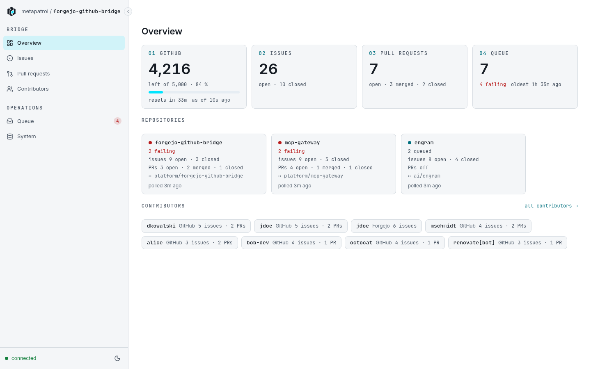
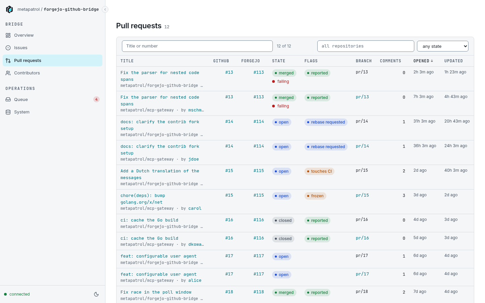
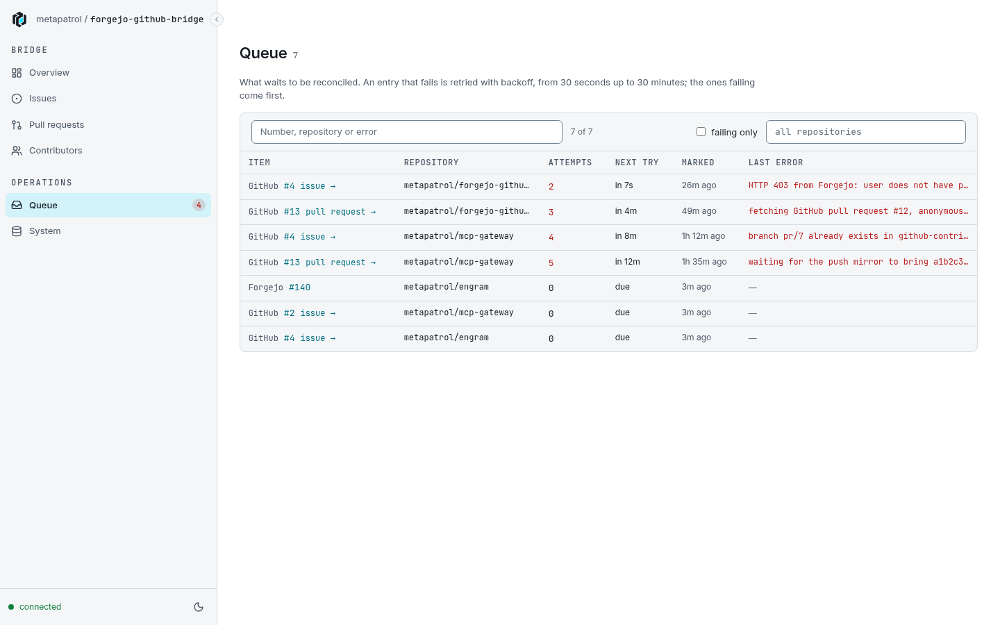
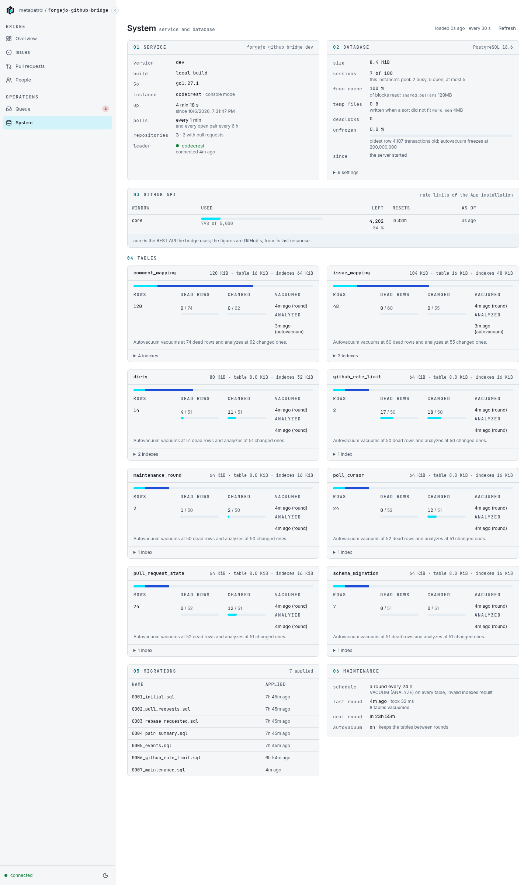

# Console

A read-only web console over what the bridge holds: the bridged repositories,
every issue and pull request with links to both sides and its history, who
opened them, and the queue, with the last error of whatever is stuck; and
the service itself, its GitHub rate limit and its database. It answers the questions the
metrics cannot: *where is alice's pull request*, *why is this issue not on
GitHub*, *what is the bridge retrying, and why*.

It is optional, off by default, and changes nothing.



**Contents**

- [Turning it on](#turning-it-on)
- [Opening it](#opening-it)
- [What it shows](#what-it-shows)
- [The API](#the-api)
- [A console of its own](#a-console-of-its-own)
- [What it never does](#what-it-never-does)

## Turning it on

With the chart:

```yaml
console:
  enabled: true
```

That adds a listener on port 8090 to every bridge pod, and a Service
`<release>-console` for it. Probes and metrics stay on their own port, so who
may reach the console is decided apart from them.

Without the chart, set `BRIDGE_CONSOLE_ADDR`, for example to `:8090`. It must
differ from `BRIDGE_LISTEN_ADDR`.

Every replica serves the console, the one waiting for the leader lock too:
what it shows is in the database.

## Opening it

The console has no sign-in of its own. Who may open it is decided in front of
it:

```bash
kubectl -n <namespace> port-forward svc/<release>-console 8090
# http://127.0.0.1:8090/
```

or an ingress with an authenticating proxy in front of the `-console` Service:
oauth2-proxy, the ingress controller's own authentication, or whatever your
single sign-on offers. With `networkPolicy.enabled`, list that proxy's pods in
`console.networkPolicyFrom`; nothing else is let in.

Treat access to the console like read access to the bridged repositories'
issue lists. It shows the numbers of internal Forgejo issues that are queued,
and the bridge's error messages, which name repositories and accounts.

## What it shows

| View | |
|---|---|
| Overview | how much of the GitHub rate limit is left, open issues and pull requests, the queue and how much of it is failing, and every repository, problems first, with a filter once there are ten or more; a warning when no instance is doing the work |
| A repository | opened from its tile on the overview: its configuration, its counts, how far each poll has read on each side, its queue, and its newest open issues and pull requests in panels of their own |
| Issues | every issue pair, newest first; searchable by title or number, sortable by every column, filterable by repository, state, author and the side it was opened on. An issue links to both sides and shows its history: when it was paired and from where, every comment that crossed, in which direction and with links to both sides, and its queue entry |
| Pull requests | every imported pull request, with its state and flags: touches CI, frozen, rebase requested, outcome reported; searchable and sortable like the issues. One links to both sides and shows its history, contrib branch, imported head and the bridge's rebase comment |
| Contributors | who opened the issues and pull requests the bridge holds, the most active first, searchable and sortable; a contributor's page lists what they opened. The bridge records who opened a pair, not who wrote its comments |
| Queue | what waits to be reconciled, the failing entries first, with attempts, when the next try is due, and the last error in full; searchable by number, repository or error |
| System | the service (version, uptime, schedule, the instance doing the work), the GitHub rate limit, and the database: size, connections, cache hit ratio, transaction age against the wraparound limit, every table with its dead rows against autovacuum's threshold and its indexes, the schema version, the maintenance PostgreSQL runs now, and the bridge's own maintenance rounds: when the last ran, what it did, when the next is due |

Lists load more as they are scrolled; their search, sort and filters are in
the address, so a view can be linked. The repository filter suggests
repositories as one types.







Every view follows changes as they happen: the bridge's database announces
each one, and the console streams it to the browser, which reloads what it
shows. While the stream reconnects, the status at the bottom of the
navigation says so: what is shown may not be current. A tab left open across
an upgrade reloads onto the new version by itself.
A pair's title is the one GitHub shows, recorded when the bridge last
reconciled it; a pair the bridge has not reconciled since an upgrade shows its
numbers until it does.

## The API

The console is a single-page application over a small JSON API, which can be
read on its own:

| Endpoint | |
|---|---|
| `GET /api/v1/status` | this instance, the instance holding the leader lock, the queue, the GitHub rate limit |
| `GET /api/v1/repositories` | the configured pairs with counts, queue and poll cursors; `pullRequests` keeps those that import them, or not |
| `GET /api/v1/pairs` | pairs, filtered by `repository`, `kind`, `state`, `origin`, `author` and `q` |
| `GET /api/v1/pairs/{id}` | one pair with its comment pairs |
| `GET /api/v1/queue` | queued entries, by `repository`, `q`, optionally `failing` only |
| `GET /api/v1/authors` | who opened the pairs, by `q` |
| `GET /api/v1/system` | the service, the database, its tables and their upkeep |
| `GET /api/v1/events` | changes as Server-Sent Events: which pair, queue entry or cursor changed, never its content |
| `GET /api/v1/openapi.yaml` | the specification all of the above is generated from |

Every list (`/repositories`, `/pairs`, `/queue`, `/authors`) is searched with
`q`, sorted with `sort` (a column, descending with a leading `-`) and paged
with `limit` and `cursor`, the conventions of mcp-gateway's inspect API.
Without `limit` a list comes whole; with it, each answer has a `nextCursor`
to read on from. A cursor names the row a page ended with rather than an
offset, so rows added meanwhile neither repeat nor skip, and it is only
accepted with the filters, `q` and `sort` it was handed out for.

[api/openapi-v1.yaml](../api/openapi-v1.yaml) is the contract: the server and
the console's client are both generated from it.

## A console of its own

`BRIDGE_MODE=console` runs the binary as a console and nothing else: no
polling, no leader lock, no GitHub App, no Forgejo tokens. It needs the
database, the repository file and `BRIDGE_FORGEJO_URL` (or
`BRIDGE_FORGEJO_WEB_URL`) for its links, and listens on `:8090` unless
`BRIDGE_CONSOLE_ADDR` says otherwise.

Its session is read-only: PostgreSQL refuses any write it would attempt. It
does not migrate, so it can use a role that may only read:

```sql
CREATE ROLE bridge_console LOGIN PASSWORD '…';
GRANT CONNECT ON DATABASE bridge TO bridge_console;
GRANT USAGE ON SCHEMA public TO bridge_console;
GRANT SELECT ON ALL TABLES IN SCHEMA public TO bridge_console;
ALTER DEFAULT PRIVILEGES FOR ROLE bridge IN SCHEMA public GRANT SELECT ON TABLES TO bridge_console;
```

It refuses to start on a database a bridge of its version has not migrated
yet. Its live updates need nothing more: listening for the database's change
announcements is allowed to a session that may only read. With a role that
is not the bridge's own, PostgreSQL may hide which host holds the leader
lock; the console then says only that one does.

## What it never does

- **Ask GitHub or Forgejo anything.** Everything comes from the bridge's
  database, so the console costs no rate limit, and nothing leads from it to
  the bridge's credentials.
- **Change anything.** There is no "retry now", "unfreeze" or "forget this
  pair": each would change the bridge's state around the reconciler's rules,
  and an endpoint that can do that has to be protected like a credential.
  Every other method than `GET` and `HEAD` is refused, and the queries run in
  read-only transactions.
- **Show what is not public.** No bodies or comments, no tokens, no DSN. A
  pair's title is GitHub's; a Forgejo issue whose publish label was removed
  keeps the title it had in public.
