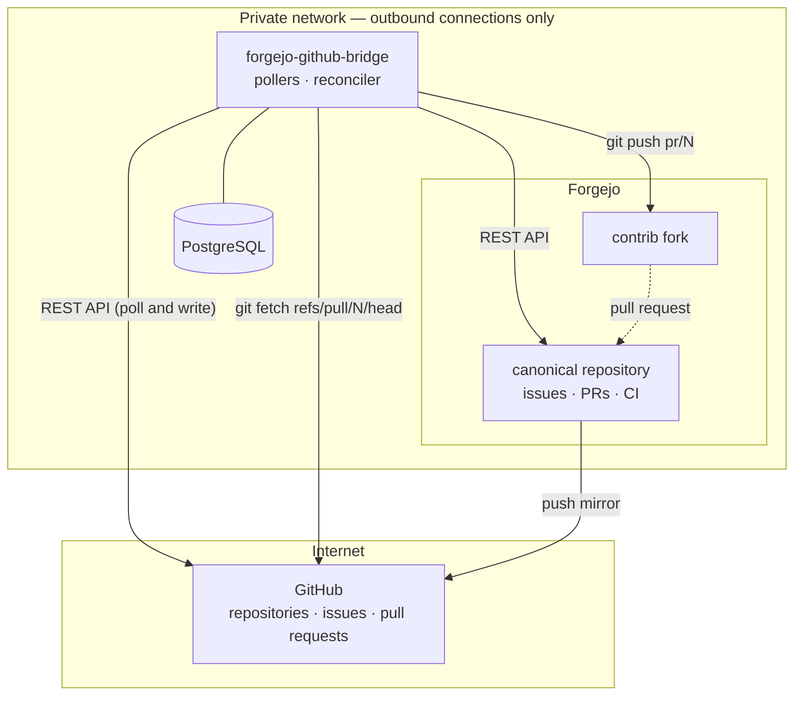
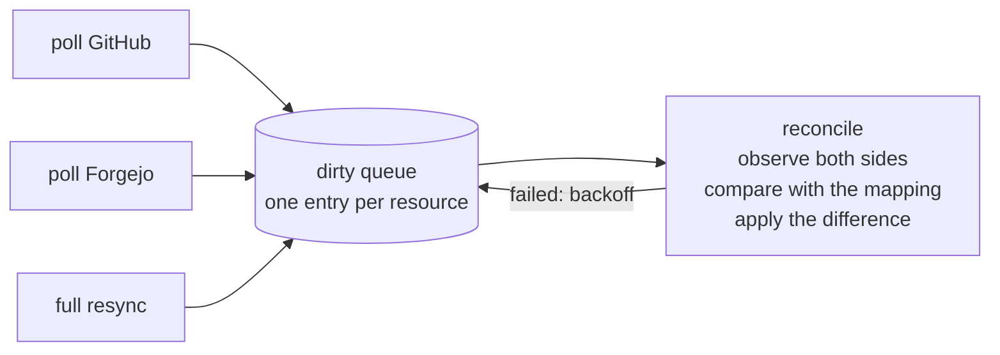
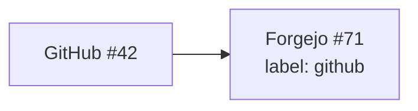
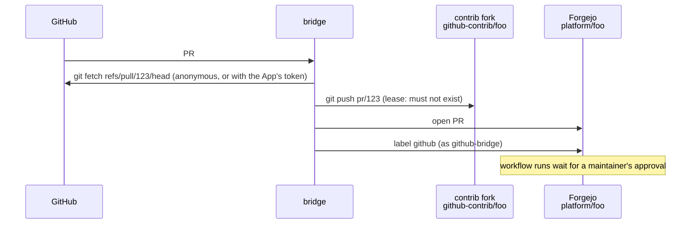
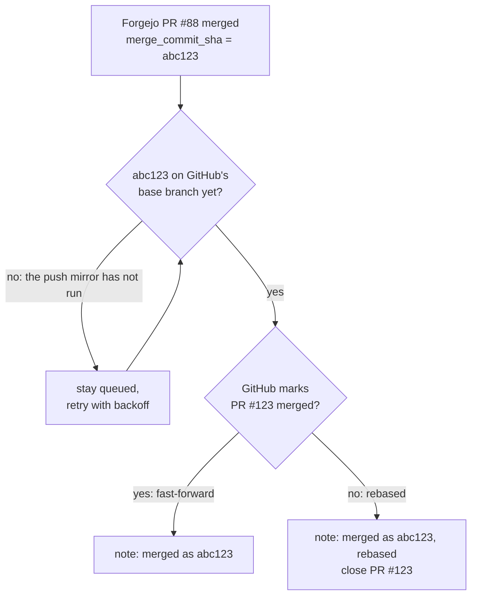
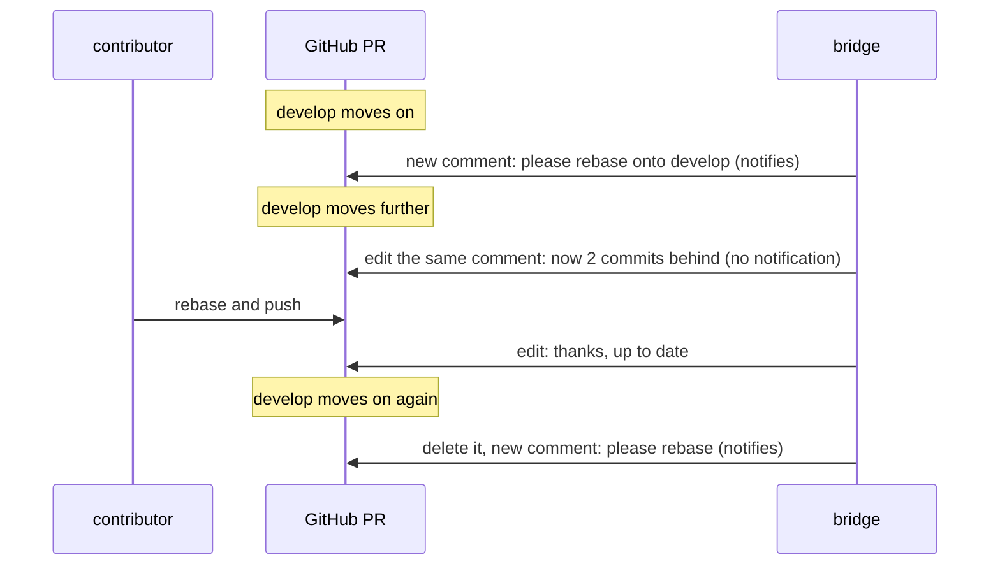

# Design

The design record of forgejo-github-bridge: what it is for, the decisions
that shaped it and the reasons for them, including the ones that were
rejected. The other documents describe how the bridge works and how to run
it; this one explains why it works that way.

**Contents**

1. [Purpose](#1-purpose)
2. [Goals](#2-goals)
3. [Why polling](#3-why-polling)
4. [Architecture](#4-architecture)
5. [Processing model](#5-processing-model)
6. [Polling](#6-polling)
7. [State](#7-state)
8. [Identities and credentials](#8-identities-and-credentials)
9. [Repository configuration](#9-repository-configuration)
10. [Issues](#10-issues)
11. [Pull requests](#11-pull-requests)
12. [CI isolation](#12-ci-isolation)
13. [Content translation](#13-content-translation)
14. [Loop prevention](#14-loop-prevention)
15. [Security properties](#15-security-properties)
16. [Threat model](#16-threat-model)
17. [Deployment](#17-deployment)
18. [Implementation stack](#18-implementation-stack)
19. [Phases](#19-phases)
20. [Non-goals](#20-non-goals)
21. [Prior art](#21-prior-art)
22. [Architectural principle](#22-architectural-principle)
23. [Inspection API and console (proposal)](#23-inspection-api-and-console-proposal)

---

## 1. Purpose

`forgejo-github-bridge` connects a private Forgejo installation to the public GitHub repositories it push-mirrors to.

The primary use case is an organization or developer who:

- uses Forgejo as the authoritative development platform,
- keeps Forgejo completely private and inaccessible from the public internet,
- mirrors source code from Forgejo to GitHub,
- publishes projects as open source,
- wants external contributors to use the familiar GitHub issue and pull request workflow,
- but wants maintainers to keep working exclusively in Forgejo.

GitHub is the public collaboration frontend. Forgejo remains the authoritative system for development, issue management, CI, review and merge.

The bridge runs entirely inside the private network and only makes outbound connections. It has no public endpoint.

---

## 2. Goals

- GitHub issues imported into Forgejo.
- GitHub pull requests imported into Forgejo as real pull requests.
- Comments projected in both directions on bridged issues and pull requests.
- Contributor pushes to a GitHub pull request reflected in the Forgejo pull request.
- Review, CI and merge in Forgejo, with the outcome reported back to GitHub.
- Forgejo-native issues stay private unless explicitly published.
- Untrusted contributor code never runs with secrets or unreviewed on private CI.
- No public exposure of Forgejo and no public component at all.
- Reliable operation across restarts and outages of either side.
- Idempotent reconciliation instead of event forwarding.
- Minimal infrastructure: one process and a PostgreSQL database, and no assumptions about where either runs.

The project intentionally does not become a generic GitHub/Forgejo replication system.

---

## 3. Why polling

The bridge polls GitHub instead of receiving webhooks.

Webhooks would require a publicly reachable component. That component would need its own deployment, TLS, a trust relationship with the private side and a protocol between the two, and it would be the part of the system most exposed to attack. What it buys is latency.

For open-source contribution traffic, latency of a minute is irrelevant. Polling costs little:

- The GitHub REST API supports `since` filters on issues and comments, so each poll returns only what changed.
- Conditional requests (`If-None-Match` / ETag) that answer `304 Not Modified` do not count against the rate limit.
- A GitHub App installation has at least 5,000 requests per hour, far above what a handful of repositories needs at a 60 s interval.

Polling also removes a class of failure: there are no missed deliveries to recover from. Every poll observes current state, and an outage simply delays the next observation.

---

## 4. Architecture



A single binary, `forgejo-github-bridge`, runs inside the private network. Its state lives in a PostgreSQL database.

Forgejo's existing push mirror stays responsible for moving code to GitHub. The bridge never pushes to GitHub and never pushes to the canonical Forgejo repository.

---

## 5. Processing model

The bridge follows the controller pattern:



Pollers do not act on what they see. They only mark resources dirty:

```text
repository = metapatrol/foo
side       = github
number     = 123
```

Five changes to the same pull request between two polls become one reconcile. A reconcile reads the current state from both systems and the stored mapping, and converges them. Running a reconcile twice has the same effect as running it once.

Two additional triggers mark resources dirty:

- a periodic full resync of all open bridged resources (for example every 6 h), which catches anything the incremental polls cannot see, such as deletions;
- an optional Forgejo webhook to the bridge's in-cluster endpoint, used only as a hint to reconcile sooner. It is never required for correctness.

---

## 6. Polling

Per configured repository, each GitHub poll issues:

```http
GET /repos/{owner}/{repo}/issues?state=all&sort=updated&since=<cursor>
GET /repos/{owner}/{repo}/issues/comments?sort=updated&since=<cursor>
```

The issues endpoint includes pull requests, and the comments endpoint covers pull request conversation comments. Pull request head changes are detected by reading `head.sha` during reconcile.

The Forgejo side uses the equivalent endpoints:

```http
GET /api/v1/repos/{owner}/{repo}/issues?state=all&since=<cursor>
GET /api/v1/repos/{owner}/{repo}/issues/comments?since=<cursor>
```

Cursors are stored per repository, side and stream (issues, comments). A cursor is the latest update time the forge itself reported, never the bridge's clock. A poll moves its cursor only after all resulting resources have been marked dirty, and each query overlaps the previous one by two minutes so eventual consistency on the forge's side cannot lose updates. Duplicates are harmless because reconciliation is idempotent.

The overlap has a cost: a cursor only moves when something newer turns up, so in a quiet repository the most recent change would be read, and reconciled, on every poll. The poller therefore remembers, in memory, what it already queued within the overlap window and queues an item again only when its update time moved. After a restart the window is read once more, which is exactly what the overlap is for.

Comments written by the bridge's own accounts are not queued: their issue changed because the bridge changed it.

Polls that fail are retried at the next interval; the rate-limit budget is exported as a metric (§18).

---

## 7. State

The bridge keeps its state in PostgreSQL. Which PostgreSQL is not its concern: it needs a connection string and a database whose schema it owns.

| Table | Holds |
|---|---|
| `issue_mapping` | repository, kind (`issue` or `pull`), GitHub number, Forgejo number, origin (`github` or `forgejo`), the state both sides had after the last reconcile |
| `comment_mapping` | a comment pair: the mapping it belongs to, both IDs, origin |
| `pull_request_state` | per pull request pair: contrib branch, imported head, open/merged/closed, frozen, touches CI, the rebase comment and whether it asks for a rebase, whether the outcome was reported |
| `poll_cursor` | repository, side, stream, cursor |
| `dirty` | repository, side, number, `marked_at`, `not_before`, attempts, last error |

The mapping tables are the authority on what corresponds to what. Every projection additionally carries a hidden marker:

```html
<!-- forgejo-github-bridge origin=github kind=comment id=927362 -->
```

The marker is not trusted: any contributor can write it into their own text. It exists so a lost database can be rebuilt by scanning bridge-authored items, and so a human reading the raw text can tell where it came from. Only items authored by the bridge's own identities are considered during such a rebuild.

Markers are also stripped from all text before it crosses the bridge, so a contributor who pastes one cannot make a projection claim a second, forged origin.

The dirty queue is a table keyed by `(repository, side, number)`. A mapped issue is always keyed by its GitHub number, so a change on each side of one pair is one entry. Marking a resource dirty is an upsert that only moves `marked_at`, which is what coalesces bursts; it leaves the entry's backoff alone, so a burst of changes to a resource that keeps failing does not turn into a burst of failing attempts. After a successful reconcile the entry is deleted only if `marked_at` is unchanged: a change that arrived while it ran keeps it queued.

A single worker drains the queue. The two halves of a pair can both be queued, and two workers reconciling the same pair would each see a comment without a projection and each create one. The issue traffic of an open-source project does not need more than one.

A reconcile that fails leaves its entry queued with exponential backoff, from 30 seconds up to 30 minutes, and the error recorded in `last_error`.

Only one bridge instance may poll and reconcile at a time. It holds a PostgreSQL advisory lock for as long as it is active; a second replica waits on the lock and takes over when the first one dies. This gives failover without a separate leader-election mechanism.

Schema migrations are embedded in the binary and applied at startup under the same lock.

Backups, point-in-time recovery and failover of the database belong to whoever runs it. If the database is nevertheless lost, the markers allow the mappings to be rebuilt:

- The first poll of each side, which is the first poll after a loss, reads every issue the bridge's own account opened and records the pairs their markers name.
- Before creating any projection, the bridge looks for one it opened within the last day with the same marker. This covers a process that died between creating an issue and recording it.
- Comments are recovered while their issue is reconciled: a bridge-authored comment whose marker names a source without a mapping is adopted instead of projected again.

A fully stateless design, keyed only by markers, is not sufficient here: the pull request lifecycle needs the imported head SHA, the owning branch and state transitions that markers cannot express reliably.

---

## 8. Identities and credentials

### GitHub

The bridge authenticates as a **GitHub App** installed on the public repositories. Its comments appear as `<app-slug>[bot]`, which makes bridge-authored content unambiguous for both contributors and the reconciler.

The App's name is not configured anywhere. The bridge is configured with the App ID and private key only, and reads the slug from `GET /app` at startup to derive its own bot login. Any App name works, and renaming the App needs no configuration change.

| Permission | Access |
|---|---|
| Metadata | read |
| Issues | read and write |
| Pull requests | read and write |
| Contents | read — only for private repositories, to fetch pull requests |
| Commit statuses | read and write — phase 3, for CI results |

The App's private key lives with the bridge's other secrets, as a file.

Git fetches of `refs/pull/N/head` need no credentials from a public repository. From a private one, the bridge retries a failed anonymous fetch with the App's installation token, restricted to that repository and handed to git through its environment; the App then needs *Contents: read*. Public repositories never see the token.

### Forgejo

The bridge uses two Forgejo accounts with different privileges:

| Account | Does | Access to the canonical repository |
|---|---|---|
| `github-bridge` | issues, comments, labels, pull request state | write, but excluded from branch protection push lists |
| `github-contrib` | owns the contrib repositories (§11), opens pull requests from them | read only |

The split exists for CI: pull requests are authored by an account that is neither a collaborator nor trusted, so Forgejo treats them as untrusted fork pull requests (see §12).

Tokens use the narrowest scopes Forgejo offers for each account. For `github-bridge` in phase 1 that is `write:issue`, `read:repository` and `read:user`; write access to the repository is needed because the bridge closes and reopens issues other people opened, and creates the import label.

---

## 9. Repository configuration

The bridge only operates on repositories it is configured for. Nothing is discovered automatically.

Scalars and credentials come from environment variables (`BRIDGE_*`, see [configuration](configuration.md)); a credential can also be read from a file named by the same variable with `_FILE`, as Docker secrets and systemd credentials provide them. The repository list and the user mapping come from a YAML file, because they are structured and because they are the part an operator edits. Unknown keys in the file are refused: a misspelt `publishlabel` silently falling back to the default is how an issue ends up public under a label nobody meant.

Forgejo is usually reached on an in-cluster address while people's links use its public hostname. Both are configured (`BRIDGE_FORGEJO_URL`, `BRIDGE_FORGEJO_WEB_URL`), and a link starting with either is internal (§13).

```yaml
repositories:
  - github: metapatrol/mcp-gateway
    forgejo: metapatrol/mcp-gateway
    contrib: github-contrib/mcp-gateway
    targetBranches: [develop]
    publishLabel: public

userMapping:
  jdoe: janedoe          # Forgejo login → GitHub login, for mentions only
```

Every Git URL, every repository name and every branch the bridge touches is derived from this file. Nothing read from GitHub can name a repository, remote or branch outside it.

---

## 10. Issues

### GitHub → Forgejo

Every GitHub issue in a configured repository is imported:



The Forgejo issue body starts with attribution and keeps the original link:

> Reported by [alice](https://github.com/alice) via GitHub: https://github.com/metapatrol/foo/issues/42

Title and body follow the GitHub issue; an edit to them in Forgejo is overwritten. Labels, milestones and assignees set in Forgejo belong to the maintainers and are never touched.

Closing or reopening the issue on either side does the same on the other. The mapping stores the state both sides had after the last reconcile; the side that differs from it is the side that acted.

Closed issues are never imported: a projection of something already finished helps nobody. The same holds for pull requests in phase 1, and for GitHub issues opened before a repository's optional `importSince`.

If one issue of a pair is deleted, the mapping is dropped. When the deleted one was the source, its projection is closed.

### Forgejo → GitHub

Forgejo-native issues are **private by default**. Only an open issue carrying the configured `publishLabel` (default `public`) is created on GitHub. Removing the label afterwards freezes the pair in both directions: the GitHub issue is not deleted, and neither further edits nor comments cross, since replies to it would carry the conversation on in public.

The GitHub projection names its author only when the Forgejo login is in `userMapping`; otherwise it says "a maintainer". A Forgejo login is an internal detail.

This is deliberately opt-in. Issue management happens in Forgejo, and a forgotten label must not publish internal work.

### Comments

On a bridged issue, comments flow in both directions. A Forgejo comment starting with `/internal` is never projected, so maintainers can discuss a public issue among themselves in place.

Editing a comment updates its projection. Editing a Forgejo comment to start with `/internal` withdraws its projection from GitHub; editing the prefix away publishes it. Deleting a comment deletes its projection; deletions are detected by the periodic full resync, since incremental polls cannot observe them. A projection somebody deleted by hand is written again.

---

## 11. Pull requests

### Import

A GitHub pull request is imported when it targets one of the configured `targetBranches`. A pull request against any other branch gets a single explanatory comment and is not imported.



The **contrib repository** is a Forgejo fork of the canonical repository, owned by `github-contrib`. Importing into a separate fork instead of a branch of the canonical repository solves two problems at once:

- the canonical repository's push mirror never sees bridge branches, so they are neither published to GitHub nor pruned by it;
- Forgejo treats the pull request as coming from a fork, which is what CI isolation relies on (§12).

The contrib repository has no push mirror, no Actions secrets and no variables. Each pair has its own: branches are named after GitHub pull request numbers, which are unique only per repository, and the configuration refuses two pairs sharing one.

The bridge never overwrites a branch it did not push. If `pr/<n>` already exists when a pull request is imported and holds anything but that pull request's head, the import stops, stays queued, counts as failing (§18) and says in the log which branch is in the way.

The GitHub pull request **stays open**. It remains the contributor's view of the contribution for its entire lifetime.

### Updates

During reconcile the bridge compares GitHub's `head.sha` with `imported_head_sha`. When the contributor has pushed, the bridge updates `pr/123` in the contrib repository with a lease on the head it pushed last, and the Forgejo pull request picks up the new commits.

The `pr/*` branches belong to the bridge. If a branch's current head differs from `imported_head_sha`, something other than the bridge pushed to it. The bridge then stops updating that pull request and comments on it in Forgejo instead of overwriting the change. Maintainer changes to a contribution belong in follow-up commits after the merge.

### Conversation

Conversation comments on the pull request flow in both directions, with the same rules as issues (§10). Forgejo review summaries are projected as comments (phase 2). Line-level review comments are projected as GitHub review comments in phase 3.

### Merge

The merge strategy is the repository's, configured in Forgejo. The bridge was built for repositories that merge by **rebase, then fast-forward**, and does not ask for anything else. What GitHub shows afterwards depends on whether the rebase had anything to do:

| At merge time | In Forgejo | On GitHub |
|---|---|---|
| the pull request is up to date with its base | a plain fast-forward; the contributor's SHAs are kept | GitHub sees the head commit on the base branch and marks the pull request **merged** by itself |
| the base has moved on | the commits are rebased and get new SHAs | GitHub cannot recognise the merge; the pull request stays open |

A rebase keeps each commit's **author**; only the committer becomes the maintainer, with the e-mail address of their Forgejo account (§17). The contributor stays in the history and GitHub attributes the commits to them either way. What the second case loses is only the pull request's merged state.

The bridge handles both. The conversation is carried across before the pull request is closed or reported, so a maintainer who closes with a comment is read on GitHub in that order:



A squash merge is handled like the rebased case, and additionally loses per-commit authorship; repositories that care about contributor credit should not offer it.

### Rebase requests

Where the merged state matters, Forgejo's branch protection on the base branch can block merging an outdated pull request. Every merge is then a plain fast-forward, and GitHub always shows the pull request as merged.

The bridge cannot read that setting: Forgejo serves branch protections to repository admins only, and the `github-bridge` account is deliberately not one (verified on Forgejo 16). A per-repository `rebaseRequests` setting therefore mirrors it, and is meant to be switched on together with the protection. When it is on and an imported pull request is behind its base, the bridge asks the contributor on GitHub to rebase:



There is never more than one such comment on a pull request, and the contributor is notified exactly once each time they have something to do. GitHub notifies about new comments, not about edits, so:

| Transition | What the bridge does |
|---|---|
| up to date → behind (the first time, or again after a rebase) | a **new** comment asking for a rebase; the previous one, saying it was up to date, is deleted |
| behind → still behind (the base moved further) | the existing request is **edited** with the new count; no notification |
| behind → up to date | the request is edited to say thanks, it is up to date |

With the setting off, the bridge asks nothing and a maintainer merges with a rebase as usual.

### What the bridge says

Everything the bridge says in its own voice — the rebase request, the merge report, the explanation for a pull request against the wrong branch, the warnings in Forgejo — is a Go template with a friendly default, and can be replaced globally or per repository (`messages`). A template that names an unknown field, or a message that does not exist, stops the bridge at startup, not on a contributor's pull request.

Base branches must correspond: the Forgejo pull request always targets the same branch as the GitHub pull request. The GitHub repository's default branch should be the branch contributors are expected to target (`develop` for repositories following the develop/main flow).

### Close

| When | The bridge |
|---|---|
| the Forgejo PR is closed without merging | carries the conversation across, adds a note, closes the GitHub PR |
| the contributor closes the GitHub PR | closes the Forgejo PR, deletes the contrib branch |
| the GitHub PR is reopened | imports it again, into a fresh contrib branch, and reopens the Forgejo PR |

After a merge or close, the contrib branch is deleted.

---

## 12. CI isolation

Importing a pull request means bringing untrusted code into the private network. Forgejo CI must never run it with secrets, and never without a maintainer having read it.

This is the most important security property of the bridge, and it depends on Forgejo configuration as much as on the bridge itself.

### What the bridge guarantees

- Contributor code is pushed only to the contrib repository, never to the canonical one.
- Pull requests are authored by `github-contrib`, an account without write access to the canonical repository.
- A pull request that modifies `.forgejo/` or other configured CI paths gets the label `touches-ci` and a warning comment.

### What the deployment must guarantee

- Workflows triggered by pull requests from forks **require maintainer approval** before they run. Forgejo (since v11, in use: v16) holds such runs until someone with elevated permissions approves them, unless the author is trusted. Trusted are collaborators with write access, team members with write permission on the Actions unit, repository owners and instance admins. `github-contrib` must be none of these.
- **Never use "Approve always" on a bridged pull request.** It trusts the pull request author permanently, and the author is `github-contrib`, the account behind every imported contribution. One click would let every future contributor run CI unreviewed. Only "Approve once" is acceptable; it covers the pending runs, and every new push needs a new approval. If "Approve always" is clicked by mistake, the trust must be revoked immediately in the repository settings. The bridge cannot detect it: Forgejo's API does not expose who is trusted. The `touches-ci` warning repeats the rule on every pull request that changes CI configuration.
- The approval gate must be verified with a test pull request before the first real import. Forgejo's documentation describes it for public repositories on instances with open registration; whether it applies unconditionally on this instance is part of that test.
- Fork pull request runs receive no secrets. This is Forgejo's default for `pull_request` events from forks.
- No workflow uses `pull_request_target` together with a checkout of the pull request head.

### Why runner labels are not enough

For `pull_request` events the workflow files come from the pull request itself. A contributor can change `runs-on` and choose any runner label. Restricting untrusted jobs to an isolated runner therefore cannot be enforced through labels. The approval gate is the control; runner isolation is defence in depth.

Approving a run is a security decision. The maintainer approves after reading the diff, including every change under `.forgejo/`.

---

## 13. Content translation

Text crossing the bridge is rewritten so that it means the same thing on the other side and leaks nothing.

| Element | GitHub → Forgejo | Forgejo → GitHub |
|---|---|---|
| `#N` reference | mapped Forgejo number, else link to the GitHub item | mapped GitHub number, else `` `internal reference` `` |
| `@user` mention | link to the GitHub profile; never a Forgejo mention | mapped via `userMapping`, else plain text without `@` |
| Links to the Forgejo host | — | a link to a mapped issue points at its GitHub counterpart; any other becomes its link text, or `` `internal link` `` when bare |
| Attachments and images | kept as links (GitHub-hosted) | `` `attachment not available publicly` ``; GitHub's API cannot receive uploads |
| Commit SHAs | unchanged | unchanged; the push mirror publishes them |

A mention must never notify an unrelated account that happens to share a name in the other system.

Placeholders are set as code spans, so that a reader on GitHub sees at a glance that something was taken out, rather than reading it as what the author wrote.

---

## 14. Loop prevention

A change the bridge made must not come back as a new change.

The reconciler ignores every item authored by the bridge's own identities: the GitHub App bot on GitHub, `github-bridge` and `github-contrib` on Forgejo. For a projection that exists it renders what the projection should say from the current source and writes only if that differs from what is there, so re-reading its own write is a no-op. No hash is stored: the comparison is against the forge's current text, which also repairs a projection somebody edited by hand.

Markers play no role in loop prevention (see §7).

---

## 15. Security properties

### No inbound connectivity

The bridge has no public endpoint. It connects out to GitHub's API and to github.com for Git fetches.

### Bounded Git operations

| Operation | Ref | Where |
|---|---|---|
| fetch | `refs/pull/<n>/head` | configured GitHub repositories only |
| push | `refs/heads/pr/<n>`, with a lease | configured contrib repositories only |

The bridge never pushes to a canonical repository and never pushes to GitHub. Code reaches GitHub only through the push mirror, i.e. only after a maintainer has merged it in Forgejo.

### Untrusted input

Everything read from GitHub is untrusted: titles, bodies, comments, branch names, commit content. It is data. It is never interpreted as configuration, repository names, Git URLs or commands. Pull request code is handled by §12.

### Credentials

The bridge holds the GitHub App private key and two Forgejo tokens. All of them live in the private network. None of them is useful to anyone who cannot already reach that network, and none grants push access to a canonical repository or GitHub.

---

## 16. Threat model

The attacker is an arbitrary GitHub user who can open issues, pull requests and comments on a public repository.

They may attempt to:

| Attack | Mitigation |
|---|---|
| Run code on private CI | fork PR from untrusted account, approval gate, no secrets (§12) |
| Exfiltrate secrets via modified workflows | no secrets for fork PRs; `touches-ci` warning (§12) |
| Get code into Forgejo branches that matter | pushes only to contrib repository `pr/*` (§11, §15) |
| Make the bridge act on other repositories | configuration allowlist; nothing derived from GitHub input (§9) |
| Spoof bridge state with forged markers | markers are not trusted; mapping tables are authoritative (§7) |
| Ping or impersonate maintainers | mention rewriting; attribution lines (§13) |
| Learn about private issues | issues are private by default; references to unmapped issues are neutralised (§10, §13) |
| Exhaust resources with volume | coalescing per resource; one worker; backoff on failure; the GitHub rate limit bounds what a poll can cost |

A compromised bridge process gives the attacker its credentials: issue and pull request write access on configured GitHub repositories, and comment/issue access plus contrib-repository push access in Forgejo. It does not give push access to canonical repositories or CI secrets.

---

## 17. Deployment

The bridge is one process, configured by environment variables and one YAML
file, with a PostgreSQL database. It makes no assumption about where either
runs. Two ways are provided:

| | |
|---|---|
| Helm chart | a Deployment of one replica (two for faster failover, §7), credentials from existing Secrets, the configuration as a ConfigMap, a cluster-internal Service for `/healthz`, `/readyz` and `/metrics`, an optional ServiceMonitor and a Grafana dashboard chart |
| Docker Compose | the bridge and a PostgreSQL container, credentials as files, for a single host |

The binary runs as well under systemd or anything else that can start a
process. The chart does not create a database, and takes the connection
string from an existing Secret with a configurable key, since the Secret
usually belongs to whatever provides the database.

Once per installation, a database and the GitHub App are created.

Per maintainer who merges in Forgejo:

- Forgejo: set the account's primary e-mail to an address that may be public and belongs to the maintainer's GitHub account — their GitHub-verified address, or their `…@users.noreply.github.com` address. A merge through the web interface, and a rebase merge in particular, records the merging account as the committer of every commit, and the push mirror publishes it. An internal address would be published as it is, and GitHub could not link the committer to anyone. This is Forgejo's behaviour, not the bridge's, and applies to every commit made through Forgejo's web interface.

Per bridged repository, the one-time setup is below; [installation](installation.md) has it step by step.

1. GitHub: install the GitHub App; set the default branch to the contribution target.
2. Forgejo: create the contrib fork owned by `github-contrib`, with no push mirror and no secrets.
3. Forgejo: enable "sync on commit" for the canonical push mirror, so merges reach GitHub promptly.
4. Forgejo: require approval for fork pull request workflow runs and verify it with a test pull request.
5. Forgejo: keep the repository's merge style (rebase, then fast-forward). To have GitHub always show imported pull requests as merged, block merging outdated pull requests on the base branch and set `rebaseRequests: true` for the repository, so the bridge asks contributors to rebase (§11).
6. Add the repository to the bridge configuration.

---

## 18. Implementation stack

| Part | Choice |
|---|---|
| language | Go |
| GitHub and Forgejo | small dedicated REST clients: GitHub App auth (RS256 JWT, installation tokens restricted to one repository), shared pagination and ETag cache |
| Git | the git CLI, against a cache of bare repositories; the image is Alpine with git |
| state | PostgreSQL through jackc/pgx v5, migrations embedded |
| logs | log/slog, structured |
| metrics | Prometheus, and a Grafana dashboard chart |

No SDK for either forge. The bridge uses about a dozen endpoints on each side; an SDK would bring a major version a month and still not do the two things the shared client is for: follow pagination without ever sending a credential to a host other than the configured one, and answer an unchanged GitHub list from its ETag, which GitHub does not count against the rate limit.

Key metrics: poll duration and errors per repository and side, dirty queue depth, resources whose last reconcile failed, reconcile outcomes per kind, GitHub rate-limit remaining, age of the oldest dirty resource.

---

## 19. Phases

### Phase 1: issues

- GitHub App authentication, polling with cursors and ETags
- PostgreSQL state, migrations, advisory lock, dirty queue, reconciler
- GitHub issue → Forgejo issue
- Forgejo issue with publish label → GitHub issue
- comments in both directions, `/internal`
- content translation (§13)
- loop prevention
- periodic full resync with deletion handling
- mapping recovery from markers

Status: implemented.

### Phase 2: pull requests

- contrib repository import, `pr/<n>` branches
- Forgejo PR creation, head updates, foreign-push detection
- conversation comments and review summaries
- merge detection and verification on GitHub
- close handling in both directions
- rebase requests (per-repository `rebaseRequests`)
- `touches-ci` labelling
- configurable messages

Status: implemented; end-to-end tested against GitHub and Forgejo 16.

### Phase 3: refinement

- CI status → GitHub commit status on the PR head
- line-level review comments
- optional Forgejo webhook as a hint to reconcile sooner

### Phase 4: inspection (optional)

- read-only REST API: pairs, queue, failures, activity
- optional web console on top of it

See §23. Not started; a proposal with open questions.

---

## 20. Non-goals

- public endpoints or webhook receivers on the internet
- pushing to GitHub (the push mirror does this)
- GitHub Projects, Discussions or Actions
- Forgejo account provisioning for contributors
- identity federation between GitHub and Forgejo
- full bidirectional state replication

---

## 21. Prior art

[forgesync](https://github.com/eleboucher/forgesync) solves the issue part of the problem with the same polling approach and no state beyond markers. It differs in the points that matter for this project:

- Forgejo-native issues are published by default (opt-out via `local-only`), not opt-in.
- An imported pull request closes the GitHub pull request and moves review into Forgejo, where the contributor cannot follow. Later pushes, review feedback and the merge are not reported back.
- Imported branches go into the canonical repository, where they get secrets in CI and are published to GitHub by the push mirror.

---

## 22. Architectural principle

> GitHub is the public contribution interface. Forgejo is the private development authority. The bridge lives on the private side, reaches out, and carries intent and state across without ever letting the outside reach in.

---

## 23. Inspection API and console (proposal)

Today the bridge is observed through metrics, logs and, when something is
stuck, a query against its database. That answers "is it healthy", not "what
happened to alice's pull request" or "why is this one not on GitHub". Phase 4
adds a read-only view for maintainers and operators. Both parts are optional,
off by default, and change nothing about what the bridge does.

### Read-only REST API

Served by the bridge itself, on its own listener, cluster-internal like
everything else it serves. Described in OpenAPI, which is the source of truth
for both the server and any client.

| Endpoint | Answers |
|---|---|
| `GET /api/v1/repositories` | the configured pairs, with counts of bridged issues and pull requests, open and failing |
| `GET /api/v1/repositories/{repo}/pairs` | the pairs of one repository, filterable by kind and state: both numbers, links to both sides, origin, synced state |
| `GET /api/v1/repositories/{repo}/pairs/{github-number}` | one pair in full: its comment mappings, and for a pull request the contrib branch, imported head, frozen, touches-ci, rebase request, outcome |
| `GET /api/v1/queue` | what is queued: due when, how many attempts, the last error |
| `GET /api/v1/activity` | what the bridge did, newest first: every write, with side, kind, action and both numbers |
| `GET /api/v1/status` | leader or waiting, poll cursors and last successful polls, rate-limit budget, build |

Activity needs one addition: a bounded table recording each write the bridge
makes (today they are only counted in `changes_total`). Everything else reads
existing state.

What the API never contains: tokens, keys or the DSN; titles, bodies or
comments of Forgejo issues that are not public. It returns numbers and links,
and the text of what is public anyway.

**Read-only, deliberately.** Actions such as "retry now", "unfreeze this
branch" or "forget this pair" are tempting and are left out: each is a way to
change the bridge's state that bypasses the reconciler's rules, and an
endpoint that can do it is an endpoint that has to be protected like a
credential. If one proves necessary, it gets its own design.

### Console

An optional web UI on top of the API, for the questions people actually ask:
where is this contribution, what is stuck and why, what did the bridge do
today. Shipped as a separate image, so a deployment that does not want a UI
does not carry one.

### Open questions

- **Authentication.** Cluster-internal is not enough for a UI people open in a
  browser. Behind an existing single sign-on, or an authenticating gateway in
  front of it.
- **Console technology.** A single-page application in its own image, or
  server-rendered pages from the bridge itself, for no second image and no
  build toolchain.
- **Activity retention.** How long, and whether it lives in the bridge's
  database or goes to a log store instead.

