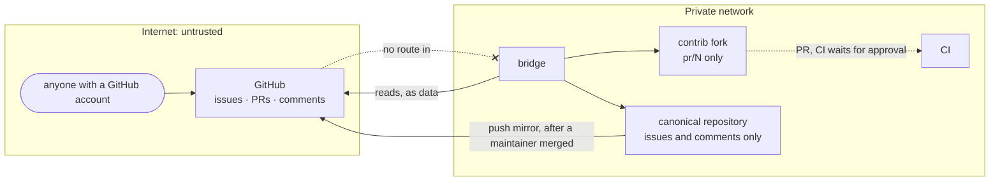

# Security

The threat model in full is [design §15–16](design.md#15-security-properties).
This page is the operator's version: what the bridge guarantees, what it
relies on, and the rules that keep it that way.

**Contents**

- [The boundary](#the-boundary)
- [Who is the attacker](#who-is-the-attacker)
- [What they cannot do](#what-they-cannot-do)
- [What it relies on](#what-it-relies-on)
- [What the bridge deliberately does not do](#what-the-bridge-deliberately-does-not-do)
- [Reporting a problem](#reporting-a-problem)

## The boundary

## Who is the attacker

Anyone with a GitHub account. They can open issues and pull requests on a
public repository, comment, and push whatever they like to their pull
request, including workflow files.

## What they cannot do

| They try to | Because |
|---|---|
| reach Forgejo or the private network | the bridge has no public endpoint; it only connects out |
| run code on Forgejo's CI unreviewed | imported pull requests come from `github-contrib`, which has no write access, so every workflow run waits for a maintainer's approval |
| read CI secrets | fork pull request runs get no secrets |
| get code into a branch that matters | the bridge pushes only to `pr/<n>` in the contrib fork, never to the canonical repository, never to GitHub. Code reaches GitHub only through the push mirror, after a maintainer merged it |
| make the bridge touch another repository | every repository, remote and branch comes from the configuration; nothing read from GitHub can name one |
| overwrite someone's work in the contrib fork | pushes carry a lease on what the bridge pushed last; anything else is refused and the branch frozen |
| forge the bridge's bookkeeping with a marker | markers are read only from items the bridge's own accounts wrote, and stripped from everything that crosses |
| learn about private issues | Forgejo issues are private unless labelled `public`; references to unpublished issues and links into Forgejo are replaced; Forgejo logins of unmapped maintainers never appear |
| make the bridge notify strangers | `@mentions` from Forgejo reach only mapped maintainers and the issue's own participants |

## What it relies on

These are not the bridge's to enforce. They are the operator's.

### CI

- **`github-contrib` has read access only** to canonical repositories: not a
  collaborator with write, not in a team with write on Actions, not an owner
  or admin. Forgejo trusts any of those, and a trusted author's workflows run
  without approval.
- **Nobody clicks "Approve always"** on an imported pull request. It trusts
  `github-contrib`, the author of every imported pull request. If it happens,
  revoke the trust in the repository's settings at once. The `touches-ci`
  warning repeats this on every pull request that changes CI configuration.
- **No workflow uses `pull_request_target`** together with a checkout of the
  pull request's head. `pull_request_target` runs the base branch's workflow
  with secrets.
- **The contrib fork has no push mirror, no secrets and no variables.** The
  bridge checks the mirror and that `github-contrib` cannot write to the
  canonical repository; secrets and variables it cannot see.
- **The approval gate is verified** with a test pull request before the first
  real one ([Installation](./installation.md#7-verify-before-the-first-real-contribution)).

Runner labels are not a boundary: an imported pull request's workflow files
are its own, and can ask for any `runs-on`. Approval is the control.

### Accounts and credentials

| Credential | Lives | Grants |
|---|---|---|
| GitHub App key | with the bridge's other secrets | issues and pull requests, read and write, on the repositories the App is installed on — and, where it is granted for private repositories, reading their contents; installation tokens are restricted per repository |
| `github-bridge` token | same | issues, comments and labels in the canonical repositories; the account has write access there |
| `github-contrib` token | same | creating and pushing to its own forks, opening pull requests; read-only on canonical repositories, which the bridge checks before every push into the fork |
| database connection string | with the bridge's other secrets | the bridge's state |

A compromised bridge gives the attacker these, and nothing more: no push to a
canonical repository, no push to GitHub, no CI secrets. Keep the namespace's
Secrets readable by the bridge's service account and administrators only.

### Maintainers' e-mail addresses

Merges through Forgejo's web interface publish the merging account's primary
e-mail as the committer. Maintainers set it to an address of their GitHub
account ([Installation](./installation.md#4-per-maintainer)).

## What the bridge deliberately does not do

- Accept webhooks or any inbound connection from the internet.
- Push to GitHub.
- Push to a canonical repository, or to any branch but `pr/<n>` in a contrib
  fork.
- Take a repository, URL, ref or command from anything a contributor wrote.
- Publish a Forgejo issue without the `public` label, or a comment starting
  with `/internal`.
- Create Forgejo accounts for contributors.

## Reporting a problem

Security problems in the bridge itself are reported privately, as described
in [SECURITY.md](../SECURITY.md), not in a public issue.
